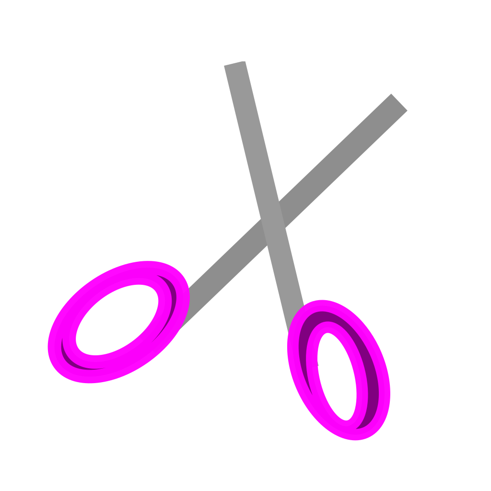

<p align="center">
  
</p>

<h1 align="center">AEON-CUT</h1>

<p align="center">
  <strong>Audio Silence & Breath Cutter for DaVinci Resolve 21</strong><br>
  Powered by pure <strong>Rust (egui)</strong> GPU-accelerated interface and high-precision Voice Activity Detection (VAD).
</p>

<p align="center">
  <a href="https://www.gnu.org/licenses/agpl-3.0"></a>
  <a href="https://www.rust-lang.org/"></a>
  <a href="https://www.blackmagicdesign.com/products/davinciresolve"></a>
  <a href="https://github.com/emilk/egui"></a>
</p>

---

## Highlights

* **100% Free & Open Source:** No monthly SaaS subscriptions ($10–20/mo saved).
* **Blazing Fast Native Rust GUI:** Built with `egui` / `eframe` — silky smooth 60+ FPS, instantaneous startup, and custom DaVinci Resolve dark studio aesthetic.
* **100% Local & Private:** No video or audio is ever uploaded to external servers or cloud providers.
* **Non-Destructive Editing (Handles Preserved):** All speech cuts preserve media references so edge handles can be trimmed or extended directly on the timeline anytime.
* **Multi-Language Support (i18n):**
  * 🇺🇸 English
  * 🇹🇷 Türkçe
  * 🇨🇳 简体中文
  * 🇯🇵 日本語

---

## Cutting Modes

1. **New Clean Timeline (Auto-Cut):**
   * Automatically creates a new timeline (`Timeline - AeonCut`) populated only with speech slices.
   * Switches Resolve's active viewer directly to the new timeline.
   * Silences are completely eliminated while keeping separate cut clips on Track 1.
2. **Append to Active Timeline:**
   * Appends the sliced speech clips directly onto your current working timeline.
3. **Add Clip Markers:**
   * Places non-destructive Cyan markers across speech and silence boundaries for manual review.

---

## Precision Controls

* **Silence Threshold (`dB`):** `-60 dB` to `-10 dB` (Default: `-32 dB`).
* **Min Silence Duration (`ms`):** Prevents cutting natural micro-pauses within sentences (Default: `350 ms`).
* **Start Breath Padding (`ms`):** Preserves the beginning consonant of words (Default: `120 ms`).
* **End Breath Padding (`ms`):** Softens the trailing edge of words (Default: `150 ms`).

---

## Quick Start

### Prerequisites

* [Rust & Cargo](https://rustup.rs/) (1.80+)
* [Python 3](https://www.python.org/) (3.6+)
* [FFmpeg](https://ffmpeg.org/) (Installed on system PATH)
* [DaVinci Resolve Studio](https://www.blackmagicdesign.com/products/davinciresolve) (21, 20, or 19)

### Running

```bash
git clone https://github.com/your-username/aeon-cut.git
cd aeon-cut
cargo run --release
```

1. Open **DaVinci Resolve** and select a video/audio clip in your timeline.
2. In Aeon-Cut, click **"🔍 Analyze Clip"**.
3. Choose your cut mode and click **"✂ Apply Cuts to Resolve"**.

---

## Testing

Run automated Voice Activity Detection tests:

```bash
cargo test
```

---

## License

This project is licensed under the **GNU Affero General Public License v3.0 (AGPL-3.0)**.  
See the [LICENSE](LICENSE) file for details.
